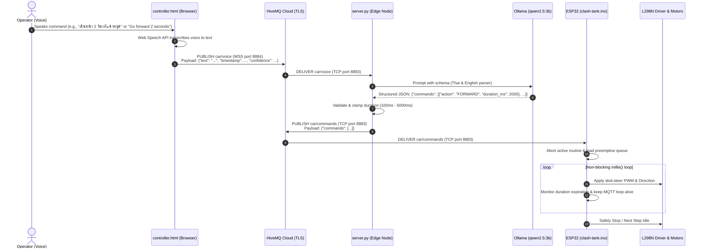

# AGENT.md — Clash Tank System Architecture & Implementation Specification

> **Target Audience**: AI agents and developers implementing, maintaining, or extending the Clash Tank codebase.
> **Repository Purpose**: An end-to-end IoT voice-controlled robotic tank using a mobile browser voice interface, an edge LLM server (Ollama with `qwen2.5:3b`), HiveMQ Cloud MQTT broker over TLS, and an ESP32 microcontroller driving an L298N dual H-bridge motor driver.

> [!IMPORTANT]
> **Mandatory AI Agent Operational Protocol**:
> Every AI agent operating on this repository **MUST** record its actions in the `## 📝 AI Agent Contribution & Usage Log` section of [`README.md`](README.md). Before concluding any turn or session that creates, modifies, or refactors files, append a new row to the history table recording the date, agent name/model, scope of work, and list of files modified.

---

## 1. System Overview & Architecture

Clash Tank translates natural spoken human voice commands (supporting both **Thai 🇹🇭** and **English 🇬🇧**) into real-time physical robotic actions via a decoupled, resilient MQTT publish/subscribe pipeline.

### High-Level Topology

```
┌─────────────────────────┐          WSS :8884 (TLS)           ┌─────────────────────────────┐
│     controller.html     │ ─────────────────────────────────> │        HiveMQ Cloud         │
│  (Mobile Web Speech API │      Topic: car/voice              │         MQTT Broker         │
│     + mqtt.js client)   │                                    │                             │
└─────────────────────────┘                                    └──────────────┬──────────────┘
                                                                              │
                                      TCP :8883 (TLS)                         │ TCP :8883 (TLS)
                                      Topic: car/voice                        │ Topic: car/commands
                                      ┌───────────────────────────────────────┘
                                      ▼
                           ┌─────────────────────┐
                           │      server.py      │
                           │  (Python MQTT +     │
                           │   Pydantic Parser)  │
                           └──────────┬──────────┘
                                      │ HTTP (localhost:11434)
                                      ▼
                           ┌─────────────────────┐
                           │    Ollama Engine    │
                           │   (qwen2.5:3b)      │
                           └──────────┬──────────┘
                                      │ Structured JSON Output
                                      │ Topic: car/commands (publish)
                                      └───────────────────────────────────────┐
                                                                              ▼
                                                               ┌─────────────────────────────┐
                                                               │  clash-tank/clash-tank.ino  │
                                                               │  (ESP32 + WiFiClientSecure  │
                                                               │       + PubSubClient)       │
                                                               └──────────────┬──────────────┘
                                                                              │ GPIO (PWM + Logic)
                                                                              ▼
                                                               ┌─────────────────────────────┐
                                                               │       L298N Dual H-Bridge   │
                                                               │       2x DC Track Motors    │
                                                               └─────────────────────────────┘
```

### End-to-End Sequence Diagram



---

## 2. Directory Map & File Responsibilities

```
clash-tank/
│
├── .env.example               # Template for Python environment variables
├── .gitignore                 # Excludes local secrets (.env, config.h), caches, build artifacts
├── README.md                  # Project introduction, hardware schematics, and quick-start guide
├── AGENT.md                   # System specification and architecture manual (this file)
├── requirements.txt           # Python dependencies for server.py
├── controller.html            # Mobile-friendly web controller with speech recognition and MQTT over WSS
├── server.py                  # Python daemon: bridges car/voice to Ollama and publishes car/commands
│
└── clash-tank/
    ├── clash-tank.ino         # ESP32 firmware: WiFiClientSecure, PubSubClient, motor state machine
    └── config.h.example       # Template for ESP32 WiFi & HiveMQ credentials and pin mappings
```

### File Responsibilities

| File | Primary Role | Key Technologies / Libraries |
| :--- | :--- | :--- |
| `controller.html` | Client interface hosted over HTTPS/localhost. Captures speech in Thai/English, displays real-time connection status, and publishes JSON to `car/voice`. | Web Speech API (`webkitSpeechRecognition`), `mqtt.js` (v4/v5 via CDN), Tailwind CSS / Vanilla JS. |
| `server.py` | Headless edge translation server. Subscribes to `car/voice`, queries local Ollama instance (`qwen2.5:3b`) using structured JSON constraints, validates durations, and dispatches to `car/commands`. | Python 3.10+, `paho-mqtt` (v2), `ollama` (Python SDK) or `requests`, `pydantic` (v2), `python-dotenv`. |
| `clash-tank/clash-tank.ino` | Microcontroller firmware. Connects to HiveMQ Cloud via TLS, sets 1024-byte MQTT buffer, decodes JSON via ArduinoJson, runs a preemptive non-blocking command queue, and drives L298N pins. | ESP32 Arduino Core, `WiFiClientSecure`, `PubSubClient`, `ArduinoJson` (v6/v7), ESP32 LEDC PWM. |
| `requirements.txt` | Defines pinned dependencies for `server.py`. | `paho-mqtt>=2.0.0`, `ollama>=0.3.0`, `pydantic>=2.0.0`, `python-dotenv>=1.0.0`. |
| `config.h.example` | Header template containing WiFi credentials, HiveMQ host/port/credentials, and ESP32 GPIO pin definitions. Copied to gitignored `config.h` before flashing. | C++ header format. |
| `.env.example` | Template for environment variables needed by `server.py`. | Text key-value format. |

---

## 3. Data Schemas & MQTT Topics

### 3.1 Network & Transport Specifications

- **Broker**: HiveMQ Cloud Cluster (e.g., `xxxxxx.s1.eu.hivemq.cloud`).
- **TLS Configuration**:
  - **Native TCP (Python & ESP32)**: Port **8883** with TLS encryption enabled.
  - **WebSockets over SSL (Browser)**: Port **8884**, path `/mqtt` using WSS (`wss://<host>:8884/mqtt`).
- **QoS Level**: QoS `0` (or `1`) without message retention (`retain: false`) to avoid stale motor trigger replays upon client reconnect.
- **Directionality**: Strictly unidirectional command pipeline (`car/voice` ➔ `car/commands`). No feedback/status topic.

### 3.2 Topic 1: `car/voice`

- **Publisher**: `controller.html`
- **Subscriber**: `server.py`
- **Payload Format**: JSON

```json
{
  "text": "เดินหน้า 2 วินาทีแล้วเลี้ยวซ้าย",
  "timestamp": 1773562596123,
  "confidence": 0.94
}
```

#### Field Definitions
- `text` *(string, required)*: The raw speech transcript emitted by the browser Web Speech API.
- `timestamp` *(integer, required)*: Client epoch time in milliseconds. Used by `server.py` to drop messages older than 5000ms to prevent delayed command execution.
- `confidence` *(float, optional)*: Recognition confidence score between `0.0` and `1.0`.

---

### 3.3 Topic 2: `car/commands`

- **Publisher**: `server.py`
- **Subscriber**: `clash-tank.ino` (ESP32)
- **Payload Format**: JSON (Strictly compliant with the system data contract)

```json
{
  "commands": [
    {
      "action": "FORWARD",
      "duration_ms": 2000
    },
    {
      "action": "TURN_LEFT",
      "duration_ms": 1000
    },
    {
      "action": "STOP",
      "duration_ms": 0
    }
  ]
}
```

#### Field Constraints & Enums
- `commands` *(array of objects, required)*: Ordered list of movements. Maximum 5 actions per batch.
- `action` *(string, enum, required)*: Must strictly be one of:
  - `FORWARD`: Both left and right tracks drive forward.
  - `BACKWARD`: Both left and right tracks drive backward.
  - `TURN_LEFT`: Skid-steer pivot turn (Left track reverse, Right track forward).
  - `TURN_RIGHT`: Skid-steer pivot turn (Left track forward, Right track reverse).
  - `STOP`: Both tracks immediately halted.
- `duration_ms` *(integer, required)*: Execution time in milliseconds.
  - Range for directional actions (`FORWARD`, `BACKWARD`, `TURN_LEFT`, `TURN_RIGHT`): Clamped between `100` and `5000` ms.
  - For `STOP`: Typically `0` (immediate permanent stop until next command).

---

## 4. Subsystem Specifications

### 4.1 Mobile Controller (`controller.html`)

1. **Speech Recognition Engine**:
   - Uses `window.webkitSpeechRecognition` or `window.SpeechRecognition`.
   - Supports language switching or dual recognition: Thai (`th-TH`) and English (`en-US`).
   - Default setting: Continuous listening off (`continuous = false`) or push-to-talk button to prevent audio hallucination / continuous ambient noise triggering.
2. **MQTT Connection Handling**:
   - Connects using `mqtt.js` bundle over `wss://<HIVEMQ_HOST>:8884/mqtt`.
   - Credentials (host, username, password) stored in browser `localStorage` and configured via an expandable settings drawer, preventing credentials from being hardcoded in public repos.
   - Visual UI badges indicate:
     - WebSocket Connection Status (Disconnected / Connecting / Connected).
     - Microphone State (Idle / Listening / Processing).
     - Last Transcribed Message.

---

### 4.2 Edge Translation Server (`server.py`)

1. **Ollama Integration & Model**:
   - Model: `qwen2.5:3b`.
   - Endpoint: `http://localhost:11434/api/generate` or official Python `ollama` client.
   - Output enforcement: Must use Ollama's structured outputs (`format: CommandBatch.model_json_schema()`) to guarantee 100% syntactically valid JSON matching the schema.
2. **Bilingual Prompt Engineering (Thai & English)**:
   - System instructions explicitly map both Thai and English movement vocabularies:
     - **Forward**: "เดินหน้า", "ไปข้างหน้า", "ตรงไป", "forward", "straight", "ahead", "go".
     - **Backward**: "ถอยหลัง", "ถอย", "backward", "back", "reverse".
     - **Turn Left**: "เลี้ยวซ้าย", "ซ้าย", "หมุนซ้าย", "left", "turn left", "spin left".
     - **Turn Right**: "เลี้ยวขวา", "ขวา", "หมุนขวา", "right", "turn right", "spin right".
     - **Stop**: "หยุด", "จอด", "พอ", "stop", "halt", "freeze", "brake".
   - Handles default duration inference: If no duration is explicitly spoken (e.g., "เลี้ยวซ้าย" / "turn left"), default to `1000` ms. If duration is explicitly specified (e.g., "3 วินาที" / "3 seconds"), parse to `3000` ms.
3. **Safety Clamping in Python**:
   - Uses Pydantic validators to clamp any `duration_ms` above `5000` ms down to `5000` ms.
   - Any duration below `100` ms (except for `STOP`) is raised to `100` ms.
   - Unrecognized phrases or noise produce `{"commands": [{"action": "STOP", "duration_ms": 0}]}`.

---

### 4.3 ESP32 Firmware (`clash-tank/clash-tank.ino`)

1. **Buffer Size Requirement**:
   - By default, `PubSubClient` allocates only 128 or 256 bytes for MQTT payloads. Incoming JSON command batches will be truncated, causing silent JSON parsing failures.
   - Firmware **MUST** explicitly invoke:
     ```cpp
     client.setBufferSize(1024);
     ```
     in `setup()` immediately after initializing `PubSubClient`.
2. **TLS Security Configuration**:
   - Uses `WiFiClientSecure`.
   - For HiveMQ Cloud, connect using:
     ```cpp
     wifiClient.setInsecure(); // Skips certificate validation for development, or load HiveMQ Root CA
     ```
3. **Preemptive Command Queue Architecture**:
   - A ring buffer or fixed array of `CommandItem` structures holds the in-flight sequence.
   - When a new message arrives in the MQTT callback:
     - **Interrupt active motion immediately**.
     - Clear the previous command queue.
     - Parse the incoming JSON array into the queue.
     - Reset timer markers (`currentActionStartTime = millis()`).
4. **Non-Blocking Execution Engine**:
   - **Absolute prohibition of `delay()`** during motor actions.
   - The main `loop()` maintains:
     ```cpp
     client.loop(); // Must be called frequently to maintain MQTT keep-alive
     ```
   - Motor durations are verified using `millis() - actionStartTime >= currentDuration`.
   - Once the final command in the queue finishes, motors are set to `STOP`.
5. **L298N Skid-Steer Logic & LEDC PWM**:
   - Standard L298N connections require 6 pins: `ENA, IN1, IN2` (Left Motor) and `ENB, IN3, IN4` (Right Motor).
   - ESP32 uses LEDC peripheral to control PWM on `ENA` and `ENB` (e.g., frequency 5000 Hz, 8-bit resolution, default duty cycle 200/255).
   - Skid-steer truth table:

| Action | Left Motor (IN1, IN2) | Right Motor (IN3, IN4) | ENA / ENB Speed |
| :--- | :--- | :--- | :--- |
| `FORWARD` | HIGH, LOW | HIGH, LOW | PWM (e.g., 200) |
| `BACKWARD` | LOW, HIGH | LOW, HIGH | PWM (e.g., 200) |
| `TURN_LEFT` | LOW, HIGH *(Reverse)* | HIGH, LOW *(Forward)* | PWM (e.g., 200) |
| `TURN_RIGHT` | HIGH, LOW *(Forward)* | LOW, HIGH *(Reverse)* | PWM (e.g., 200) |
| `STOP` | LOW, LOW | LOW, LOW | 0 |

---

## 5. Development & Testing Guidelines

### 5.1 Environment Setup

#### Python Server Setup
1. Ensure Python 3.10+ is installed.
2. Install Ollama and pull the target model:
   ```bash
   ollama pull qwen2.5:3b
   ollama serve
   ```
3. Set up Python virtual environment and install packages:
   ```bash
   python -m venv venv
   # Windows:
   .\venv\Scripts\activate
   # Linux/macOS:
   source venv/bin/activate

   pip install -r requirements.txt
   ```
4. Copy `.env.example` to `.env` and fill in HiveMQ Cloud credentials:
   ```bash
   cp .env.example .env
   ```

#### ESP32 Setup
1. In Arduino IDE (or PlatformIO), install:
   - ESP32 Board Core (v2.0.x or v3.x).
   - `PubSubClient` by Nick O'Leary.
   - `ArduinoJson` (v6.x or v7.x) by Benoit Blanchon.
2. Open `clash-tank/clash-tank.ino`.
3. Copy `clash-tank/config.h.example` to `clash-tank/config.h` and configure WiFi SSID/password and HiveMQ credentials.
4. Select board **ESP32 Dev Module** and appropriate COM port, then flash.

#### Web Controller Setup
1. Browsers require a secure context (`HTTPS` or `localhost`) to access the microphone Web Speech API.
2. For testing on a local machine, serve `controller.html` with a lightweight server:
   ```bash
   python -m http.server 8000
   ```
3. Open `http://localhost:8000/controller.html` or access via an HTTPS reverse proxy (e.g., ngrok or Cloudflare Tunnel) when opening from a mobile phone.

---

### 5.2 Step-by-Step Testing & Verification

1. **Broker Connectivity Test**:
   - Use HiveMQ Web Client or MQTT Explorer to connect to `xxxxxx.s1.eu.hivemq.cloud:8884` (WSS) and `:8883` (TLS).
   - Subscribe to both `car/voice` and `car/commands`.
2. **Voice Interface Verification**:
   - Click "Connect" in `controller.html`.
   - Click "Speak" and say: *"เดินหน้า 2 วินาที"* or *"Forward 2 seconds"*.
   - Confirm payload arrives on topic `car/voice` via MQTT Explorer.
3. **LLM Translation Verification**:
   - Run `python server.py`.
   - Confirm server receives the `car/voice` message and triggers Ollama.
   - Confirm structured JSON output publishes to `car/commands` within 500-1500ms.
4. **Firmware Motion Verification**:
   - Power ESP32 via USB and open Serial Monitor at `115200` baud.
   - Verify WiFi and HiveMQ connection logs.
   - Send simulated payload directly to `car/commands`:
     ```json
     {"commands": [{"action": "TURN_RIGHT", "duration_ms": 1000}, {"action": "STOP", "duration_ms": 0}]}
     ```
   - Verify serial logs confirm non-blocking execution, L298N LED indicators light up as expected, and motors stop after 1000ms.
5. **Emergency Interrupt Verification**:
   - Send a 5-second `FORWARD` command.
   - At 1 second in, publish `{"commands": [{"action": "STOP", "duration_ms": 0}]}`.
   - Confirm ESP32 immediately aborts forward motion without waiting for the 5-second timer to finish.

---

## 6. Common Pitfalls & Hardware Safety Rules

### 6.1 Hardware & Electrical Safety

1. **Common Ground is Mandatory**:
   > [!CAUTION]
   > The **GND** pin of the ESP32, the **GND** terminal of the L298N driver, and the **negative (-)** terminal of the battery pack **MUST be tied together**. Without a common ground reference, floating PWM voltages will cause erratic motor twitching, runaway conditions, or burnt GPIO pins.

2. **Power Separation & Brownout Prevention**:
   > [!WARNING]
   > **DO NOT** power DC motors directly from the ESP32 `3.3V` or `5V/VIN` pins! Dual DC motors under load can draw 1A to 2A, which collapses ESP32 supply voltage and triggers constant `Brownout detector was triggered` reboot loops.
   - Power the L298N `12V/VCC` terminal using an external battery pack (e.g., 2S/3S Li-ion or 7.4V–11.1V).
   - If the L298N onboard 5V regulator jumper is fitted, the L298N `5V` terminal can supply power to the ESP32 `VIN` pin (if input voltage is ≤ 12V). Alternatively, power the ESP32 independently via USB/separate 5V buck converter.

3. **L298N Voltage Drop Considerations**:
   - The bipolar transistors inside the L298N cause an internal voltage drop of approximately **1.8V to 2.2V**.
   - If using a 7.4V battery pack, motors will receive ~5.4V. Adjust battery sizing and PWM duty cycles accordingly.

---

### 6.2 Firmware & Protocol Traps

1. **PubSubClient Buffer Truncation**:
   > [!IMPORTANT]
   > `PubSubClient.h` has a default `MQTT_MAX_PACKET_SIZE` of 128 bytes. A JSON command payload with multiple steps can easily exceed 200 bytes. If `setBufferSize(1024)` is omitted, messages are silently dropped by the library before reaching the callback.

2. **The `delay()` Trap**:
   - Calling `delay(2000)` freezes execution on the ESP32 core.
   - During `delay()`, `client.loop()` is paused; HiveMQ Cloud's keep-alive heartbeat will expire (typically 15-60 seconds), dropping the TLS connection and forcing costly TLS handshakes upon every movement.
   - Always manage motion timing strictly with `millis()`.

3. **Failsafe Watchdog on Disconnect**:
   - If WiFi or MQTT drops while the tank is moving, the tank must not continue running indefinitely.
   - The firmware `loop()` must detect disconnection and immediately cut all motor pins to `LOW`.

4. **Speech Recognition Latency & Stale Commands**:
   - If network delay causes a message to take multiple seconds to arrive, executing a deferred forward command could crash the tank into an obstacle.
   - `server.py` evaluates the `timestamp` field from `controller.html` and drops commands where `(now - timestamp) > 5000ms`.

5. **Thai & English Tokenization Edge Cases**:
   - Thai speech does not use whitespace between words (e.g., `"เดินหน้าสองวินาที"`).
   - Prompt instructions for `qwen2.5:3b` must account for unsegmented Thai phonetics and numeral representations (both Thai script numerals `๒` and Arabic numerals `2`).
