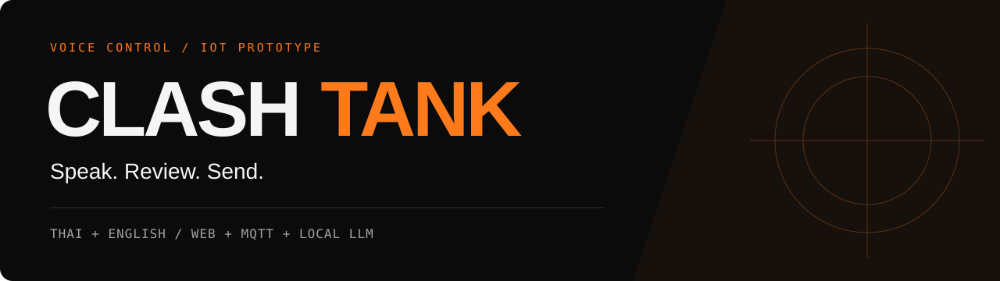
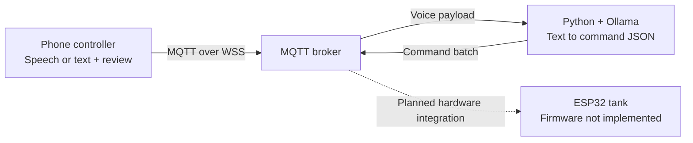

# Your voice. The next command.

**Clash Tank** explores a simple idea: control a robotic tank in Thai or English, straight from your phone. Speak or type, review the message, then send it through MQTT to a local LLM translator.

**[Launch the controller ↗](https://clash-tank.vercel.app/)** · [How it works](#how-it-works) · [Run it yourself](#run-it-yourself) · [Project status](#project-status)

**React + Vite** / **HiveMQ MQTT** / **Python + Ollama** / **ESP32 target hardware**

> **Prototype status:** the web controller is deployed. ESP32 firmware is still an empty placeholder—not a working vehicle controller. The Python backend runs separately from Vercel.

## From speech to a command

<p align="center">
  
  <br>
  <sub>The deployed controller, captured in its disconnected state.</sub>
</p>

**01 — Connect** · Open Settings and match the broker and voice topic to your backend.

**02 — Speak** · Choose Thai or English. Use the microphone or type a command.

**03 — Review & send** · Check the transcript before submitting it. Offline messages are never queued for replay.

Try a phrase like **“เดินหน้า 2 วินาที”** or **“forward for 2 seconds.”** These are example inputs, not a claim of verified vehicle movement.

## How it works



The browser captures speech; a local Ollama model interprets the transcript. Broker and topic settings connect the two. Vercel hosts **only the web interface**, not the Python process or model.

## Run it yourself

<details>
<summary><strong>Web controller — develop, test, build</strong></summary>

Requires **Node.js 22.12+**. From the repository root:

```bash
cd frontend
npm ci
npm run dev
```

Open `http://localhost:5173/`. For phone microphone access, use the hosted demo or HTTPS with a trusted certificate—not a LAN HTTP address. Browser speech support varies; text entry is available as a fallback.

From `frontend/`:

```bash
npm test          # Controller logic tests
npm run build     # Static output in dist/
npm run preview   # Preview the production build
```

Deploy only `frontend/dist/`. The root `vercel.json` configures installation and builds from `frontend/`; keep the Vercel project's Root Directory at the repository root. Never expose `.env` or backend credentials.

</details>

<details>
<summary><strong>Python translator — MQTT + local Ollama</strong></summary>

Install Ollama, download the model, and keep its service running (`ollama serve` if not already running). From the repository root in a separate terminal:

```bash
cd backend
ollama pull qwen2.5:3b
python -m venv .venv
source .venv/bin/activate  # Windows: .venv\Scripts\activate
pip install -r requirements.txt
```

For a fresh setup, run `cp .env.example .env` from `backend/`. Keep an existing `.env` instead of overwriting it; after this restructure it belongs at `backend/.env`.

Set the broker, credentials, topics, and Ollama settings in `backend/.env`, then start from `backend/` with the virtual environment active:

```bash
python server.py
```

In the web controller's Settings, use a **WSS endpoint on the same broker** and match `TOPIC_VOICE`. The controller defaults to the public HiveMQ endpoint `wss://broker.hivemq.com:8884/mqtt`; change it if your backend uses another broker.

Voice payload:

```json
{"text": "forward for 2 seconds", "timestamp": 0, "confidence": 0.95}
```

Replace `0` with the current Unix epoch time in **milliseconds** when testing; the backend rejects messages older than 5000 ms. Confidence is optional. Retained messages, low confidence, and empty text are rejected; empty command batches are not published.

</details>

<details>
<summary><strong>ESP32 — hardware work still ahead</strong></summary>

`arduino/clash-tank/clash-tank.ino` is currently empty. `arduino/clash-tank/config.h.example` provides the Wi-Fi, MQTT, and pin configuration template for future implementation; copy it to `config.h` in the same folder. Development uses Arduino IDE with ESP32 support, `PubSubClient`, and `ArduinoJson`.

Connect the ESP32, motor driver, and battery grounds together. **Never power motors directly from ESP32 pins.**

</details>

## Project status

- **Web:** deployed controller with Thai/English speech review, text fallback, local settings/history, and MQTT over WSS. Passwords stay in memory, not local storage.
- **Backend:** MQTT → Ollama → MQTT bridge. **Schema alignment is still needed:** the prompt includes `SPIN` and `duration_ms`; the current Python schema omits `SPIN` and uses `duration`. No duration clamping is enabled.
- **Hardware:** firmware, motor control, acknowledgements, and disconnect failsafes remain to be implemented.

> **Safety boundary:** **ส่งแล้ว** means submitted, not executed. **หยุดรถ** sends `STOP` through the LLM pipeline; it is **not a motor emergency stop**. Prompt rules cannot guarantee correct interpretation. Do not use a public broker for private or safety-critical control.

<details>
<summary><strong>Find your way around the code</strong></summary>

- [`frontend/`](frontend/) — React controller, HTML entrypoints, npm/Vite configuration, and [`tests/`](frontend/tests/).
- [`backend/`](backend/) — [`server.py`](backend/server.py), bilingual prompt, Python requirements, and environment template.
- [`arduino/clash-tank/`](arduino/clash-tank/) — firmware placeholder and hardware configuration template.
- [`assets/readme/`](assets/readme/) — README banner and controller screenshot.

</details>
