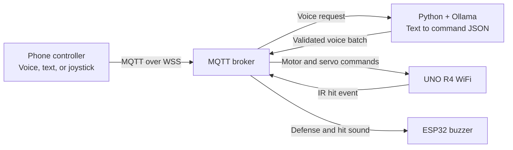

# Your voice. The next command.

**Clash Tank** is a Thai/English voice and joystick tank controller: React + Vite, MQTT, a local Python/Ollama translator, UNO R4 WiFi motor control, and an ESP32 buzzer.

**[Launch the controller ↗](https://clash-tank.vercel.app/)** · [How it works](#how-it-works) · [Run it yourself](#run-it-yourself) · [Control protocol](CONTROL_PROTOCOL.md)

> Vercel hosts only the web interface. Python, Ollama, and the physical boards run separately. Submission is not acknowledgement that the vehicle executed a command.

## Use the controller

1. Open the website. It connects automatically using saved settings; the default broker is `wss://broker.hivemq.com:8884/mqtt`. The connection modal blocks controls until MQTT connects. Failed/lost connections retry after 2.5 seconds; returning online triggers an immediate attempt. Motion commands are never replayed.
2. In **Settings**, match the broker, voice topic, and command topic to Python and both boards. Passwords stay in memory, not browser-local storage.
3. In **เสียง** mode, select Thai or English and tap the microphone. Completed speech sends automatically; low-confidence speech requires editing or repeating. Select **พิมพ์คำสั่ง** for text entry, then **ส่งคำสั่ง**.
4. In **จอย** mode, tap/drag or use arrow keys to select a direction. Releasing keeps the direction latched; select the center, Escape, or Home to stop.

<p align="center">
  
  <br>
  <sub>Earlier voice-controller screenshot; the current interface also includes joystick controls.</sub>
</p>

**โจมตี** sends one direct `ATTACK`, centers the joystick, and waits 2.5 seconds before accepting another combat action or direction. The UNO servo cycle takes approximately 2.2 seconds and blocks MQTT handling, including STOP, until it finishes. Movement never resumes automatically.

**ป้องกัน** sends one direct `DEFENSE` and centers the joystick. The ESP32 plays a fixed five-second buzzer effect. An active-low IR detection on UNO A0 publishes `Being_Attacked`; ESP32 plays a one-second hit sound, interrupting defense without resuming it. Sound timing is non-blocking; existing network calls can still delay servicing.

**Safety boundary:** the stop button and joystick center send STOP directly to `command_out`, bypassing Python/LLM, but this is **not a hardware emergency stop**. Joystick motion refreshes every 150 ms with a 500 ms lease; the firmware checks expiry cooperatively, so blocking calls can delay stopping. Voice queues have their own timed actions. Do not use a public broker for private or safety-critical control. See [CONTROL_PROTOCOL.md](CONTROL_PROTOCOL.md) for session guards, timing limits, and hardware checks.

## How it works



Joystick, combat buttons, and STOP bypass the translator. Voice requests and responses carry session/sequence metadata; old or mismatched sessions cannot start a motor queue. Sessions are stale-command guards, not authentication or a multi-controller ownership service. The protocol supports one operator and has no vehicle acknowledgement/status topic.

## Run it yourself

Each section starts from the repository root in a separate terminal.

<details>
<summary><strong>Web controller — develop, test, build</strong></summary>

Requires **Node.js 22.12+**.

```bash
cd frontend
npm ci
npm run dev
```

Open `http://localhost:5173/`. For phone microphone access, use the hosted controller or HTTPS with a trusted certificate, not a LAN HTTP address. Browser speech support varies; text entry is available as a fallback.

From `frontend/`:

```bash
npm test
npm run build     # Static output in frontend/dist/ relative to repository root
npm run preview
```

Both `/` and `/controller.html` load the controller. Deploy only `frontend/dist/`. The root `vercel.json` builds from `frontend/`; keep the Vercel project's Root Directory at the repository root. Never deploy `.env` or backend credentials.

</details>

<details>
<summary><strong>Python translator — MQTT + local Ollama</strong></summary>

Install Ollama, download the configured model, and keep its service running (`ollama serve` if not already running).

```bash
cd backend
ollama pull qwen2.5:3b
python -m venv .venv
source .venv/bin/activate  # Windows: .venv\Scripts\activate
pip install -r requirements.txt
```

For a fresh setup, run `cp .env.example .env` from `backend/`. Keep an existing `.env` instead of overwriting it. Set its broker, credentials, topics, and Ollama settings, then start from `backend/` with the virtual environment active:

```bash
python server.py
```

Match `TOPIC_VOICE` and `TOPIC_COMMANDS` to the web settings and boards. Defaults use `broker.hivemq.com`: browser WSS `8884/mqtt`, boards/Python TCP `1883`; existing `.env` values override defaults. Python enables TLS for port 8883.

The worker rejects retained, untagged, stale, low-confidence, and empty requests. Valid text goes to Ollama; trusted request session metadata is copied onto validated output. Non-STOP durations must be 1–60000 ms. Restart the updated worker with the updated firmware: legacy untagged movement packets are intentionally rejected by the boards. [CONTROL_PROTOCOL.md](CONTROL_PROTOCOL.md) describes the complete claim/request/response sequence.

Offline protocol tests, from `backend/`:

```bash
python -m unittest discover -s tests -p 'test_*.py'
```

**Known schema mismatch:** the prompt includes `SPIN` and `duration_ms`, while the Python schema omits `SPIN` and uses `duration`. Prompt rules do not guarantee correct interpretation; this restructure does not change that contract.

</details>

<details>
<summary><strong>Arduino boards — separate sketches and offline checks</strong></summary>

- **UNO R4 WiFi:** open [`arduino/clashtank/clashtank.ino`](arduino/clashtank/clashtank.ino). Keep `ControlSession.h` and `ProximityTrigger.h` beside it. Uses `WiFiS3`, `PubSubClient`, ArduinoJson 7, `LiquidCrystal_I2C`, and `Servo`. Attack servo signal: pin 11; active-low IR output: A0.
- **ESP32 buzzer:** open [`arduino/esp32buzzer-clashtank/esp32buzzer-clashtank.ino`](arduino/esp32buzzer-clashtank/esp32buzzer-clashtank.ino). Keep `BuzzerEffects.h` beside it. Uses ESP32 Arduino Core 3.x, `PubSubClient`, and ArduinoJson 7. Buzzer: GPIO 23.
- Each sketch is already in its own same-named directory. **Build/upload them separately**, never as one combined sketch. For a fresh checkout, copy each sketch's adjacent `config.h.example` to `config.h` and set Wi-Fi credentials there. Keep an existing `config.h` instead of overwriting it. These local files are ignored by Git; broker/topic settings remain in each sketch.
- Motor pins and speeds are unchanged. ENA=2/ENB=7 are not the PWM pins listed in the existing UNO R4 comment; verify wiring and enable/PWM behavior before energizing motors. Connect controller, motor driver, and battery grounds together. **Never power motors directly from microcontroller pins.**

Earlier commits contain hardcoded Wi-Fi credentials. Moving them to ignored config files does not erase Git history: rotate those credentials. Never commit a populated `config.h`.

Host-side checks require Python and a C++ compiler; the sound/IR integration check also requires an ArduinoJson 7 library checkout. From the repository root:

```bash
cd arduino
python tests/run_firmware_tests.py
python tests/run_esp32_defense_tests.py --arduinojson /path/to/ArduinoJson
```

Build artifacts stay in ignored `arduino/.build/`. These tests do not compile complete board firmware or energize hardware. Follow the [hardware validation steps](CONTROL_PROTOCOL.md#hardware-validation) with the wheels raised before use.

</details>

## Find your way around the code

- [`frontend/`](frontend/) — React UI, HTML entrypoints, npm/Vite configuration, controller artwork, and JavaScript tests.
- [`backend/`](backend/) — MQTT/Ollama worker, bilingual prompt, `voice_protocol.py`, requirements, environment template, and Python protocol tests.
- [`arduino/`](arduino/) — separate UNO/ESP32 sketch folders and host-side firmware tests.
- [`CONTROL_PROTOCOL.md`](CONTROL_PROTOCOL.md) — packet formats, lifecycle/safety limits, and hardware validation.
- [`assets/readme/`](assets/readme/) — README banner and earlier controller screenshot.
