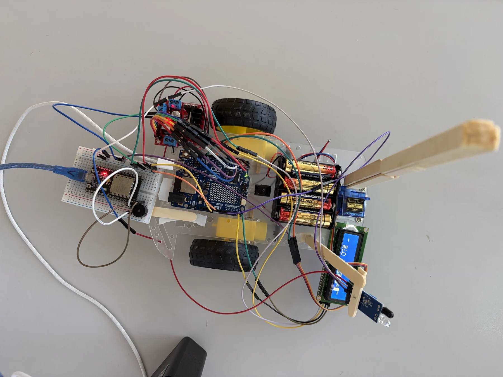
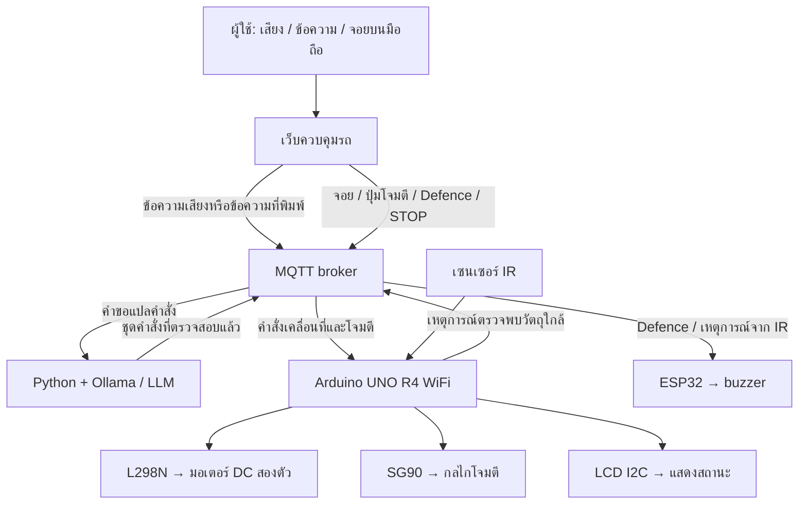
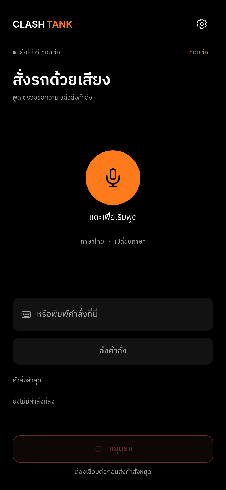

# Physical Computing Project 2026 - IT KMITL

## ClashTank — รถต่อสู้ที่สั่งงานด้วยภาษาธรรมชาติ

<p align="center">
  
</p>

**ClashTank** เป็นโครงงานรถต่อสู้ที่ผสานการควบคุมผ่านเว็บเข้ากับการสั่งงานด้วยภาษาธรรมชาติ ผู้ใช้สามารถพูดภาษาไทยหรือภาษาอังกฤษ หรือพิมพ์ข้อความ เพื่อให้โมเดลภาษาขนาดใหญ่ (LLM) แปลงข้อความเป็นคำสั่งที่รถเข้าใจ รวมถึงสั่งหลายการกระทำในประโยคเดียวให้รถทำตามลำดับได้ นอกจากนี้ยังควบคุมทิศทางและการทำงานผ่านจอยและปุ่มบนมือถือได้โดยตรง

**[เว็บไซต์รายงานโครงงาน](https://nutnoobly.github.io/clash-tank/)** · **[เปิดหน้าควบคุมรถ](https://clash-tank.vercel.app/)**

## สารบัญ

- [จุดประสงค์ของโครงงาน](#จุดประสงค์ของโครงงาน)
- [ความสามารถของระบบ](#ความสามารถของระบบ)
- [หลักการทำงาน](#หลักการทำงาน)
- [อุปกรณ์และเทคโนโลยี](#อุปกรณ์และเทคโนโลยี)
- [การจ่ายไฟ](#การจ่ายไฟ)
- [ขอบเขตและข้อจำกัด](#ขอบเขตและข้อจำกัด)
- [โครงสร้างโฟลเดอร์](#โครงสร้างโฟลเดอร์)
- [สื่อประกอบโครงงาน](#สื่อประกอบโครงงาน)
- [คู่มือติดตั้งและรายละเอียดทางเทคนิค](#คู่มือติดตั้งและรายละเอียดทางเทคนิค)
- [เอกสารอ้างอิง](#เอกสารอ้างอิง)
- [สมาชิกผู้จัดทำ](#สมาชิกผู้จัดทำ)

## จุดประสงค์ของโครงงาน

1. ศึกษาการเชื่อมโยงซอฟต์แวร์กับอุปกรณ์จริง ผ่านการรับคำสั่งและควบคุมการทำงานของรถ
2. ประยุกต์ใช้ LLM เพื่อแปลงภาษาธรรมชาติเป็นคำสั่งควบคุมฮาร์ดแวร์ รวมถึงชุดคำสั่งหลายขั้นตอน
3. ศึกษาการสื่อสารระหว่างเว็บ เซิร์ฟเวอร์ และไมโครคอนโทรลเลอร์ผ่าน MQTT
4. ฝึกใช้งานมอเตอร์ เซอร์โว เซนเซอร์ จอแสดงผล และวงจรขับ พร้อมออกแบบการจ่ายไฟให้แต่ละส่วน
5. พัฒนารูปแบบการควบคุมที่เลือกใช้ได้ทั้งเสียง ข้อความ และจอยบนมือถือ

## ความสามารถของระบบ

| ความสามารถ | รายละเอียด |
|---|---|
| สั่งงานด้วยภาษาธรรมชาติ | รับเสียงพูดภาษาไทยหรือภาษาอังกฤษผ่านเบราว์เซอร์ แล้วแปลงเป็นข้อความเพื่อส่งให้ LLM หรือพิมพ์คำสั่งแทนได้ |
| สั่งหลายการกระทำในครั้งเดียว | เช่น “เดินหน้า 2 วินาที แล้วเลี้ยวซ้าย แล้วโจมตี” ระบบแปลงเป็นชุดคำสั่งให้บอร์ดหลักทำงานตามลำดับ |
| ควบคุมด้วยมือถือ | ใช้จอยและปุ่มส่งคำสั่งตรงผ่าน MQTT โดยไม่ผ่าน LLM |
| เคลื่อนที่ | ควบคุมมอเตอร์ DC สองตัวผ่าน L298N เพื่อเดินหน้า ถอยหลัง และเลี้ยว |
| โจมตี | ใช้เซอร์โว SG90 ขยับกลไกโจมตี |
| Defence | เล่นเอฟเฟกต์เสียง 5 วินาที เป็นการจำลองด้วยเสียง ไม่มีการป้องกันทางกายภาพ |
| ตรวจจับวัตถุใกล้ | เซนเซอร์ IR ส่งสัญญาณให้ Arduino แล้วส่งเหตุการณ์ ผ่าน MQTT เพื่อให้ ESP32 เล่นเสียงตอบสนอง |
| แสดงสถานะ | จอ LCD I2C แสดงสถานะการเชื่อมต่อและข้อมูลคำสั่ง |

## หลักการทำงาน



### การสั่งด้วยเสียงหรือข้อความ

เบราว์เซอร์แปลงเสียงพูดเป็นข้อความ แล้วส่งผ่าน MQTT ไปยัง Python ซึ่งเรียกใช้ LLM ผ่าน Ollama เพื่อแปลเป็นคำสั่งของรถ หลังตรวจสอบรูปแบบคำสั่งแล้วจึงส่งกลับผ่าน MQTT ไปยังบอร์ด ส่วนการพิมพ์ข้อความจะเริ่มจากขั้นตอนส่งข้อความโดยไม่ต้องรู้จำเสียง

### การควบคุมโดยตรง

จอย ปุ่มโจมตี ปุ่ม Defence และ STOP ส่งคำสั่งผ่าน MQTT โดยตรง บอร์ด Arduino เป็นตัวควบคุมการเคลื่อนที่ เซอร์โว จอ และอ่าน IR ส่วน ESP32 รับ MQTT แยกเพื่อควบคุมเสียง ไม่มีสายข้อมูลตรงระหว่างสองบอร์ด

เว็บไซต์บน Vercel ให้บริการส่วนติดต่อผู้ใช้เท่านั้น ส่วน Python, Ollama และบอร์ดต้องทำงานและเชื่อมต่อระบบแยกต่างหาก

## อุปกรณ์และเทคโนโลยี

### ฮาร์ดแวร์

| อุปกรณ์ | จำนวน | หน้าที่ |
|---|---:|---|
| Arduino UNO R4 WiFi | 1 | บอร์ดหลัก รับ MQTT และควบคุมอุปกรณ์บนรถ |
| ESP32 | 1 | บอร์ดเสริม รับ MQTT และควบคุม buzzer |
| LCD I2C | 1 | แสดงสถานะและข้อมูลคำสั่ง |
| วงจรขับมอเตอร์ L298N | 1 | วงจรขับมอเตอร์ DC |
| มอเตอร์ DC | 2 | ขับเคลื่อนรถ |
| เซนเซอร์ IR | 1 | ตรวจจับวัตถุใกล้ |
| เซอร์โว SG90 แบบ 180° | 1 | ขยับกลไกโจมตี |
| Buzzer แบบสองขา | 1 | สร้างเอฟเฟกต์เสียง |
| ถ่าน AA อัลคาไลน์ | 4 | แหล่งจ่ายไฟสำหรับภาคกำลังของมอเตอร์ |

### ซอฟต์แวร์

- **React + Vite** — เว็บควบคุมรถและส่วนติดต่อผู้ใช้
- **ระบบรู้จำเสียงของเบราว์เซอร์** — แปลงเสียงพูดเป็นข้อความตามการรองรับของเบราว์เซอร์
- **MQTT** — สื่อสารระหว่างเว็บ เซิร์ฟเวอร์ และบอร์ด
- **Python + Ollama** — แปลข้อความเป็นคำสั่งด้วย LLM
- **โปรแกรมบอร์ด Arduino** — โปรแกรมของ UNO R4 WiFi และ ESP32 แยกกัน
- **HTML, CSS และ JavaScript** — เว็บไซต์รายงานโครงงานในโฟลเดอร์ `docs/`

## การจ่ายไฟ

- ถ่าน AA อัลคาไลน์ 4 ก้อนจ่ายเข้าภาคกำลังของ L298N เพื่อขับมอเตอร์ DC สองตัว
- Arduino รับไฟจาก USB และจ่าย 5V ให้ SG90, LCD, IR และ วงจรตรรกะของ L298N โดยถอดจัมเปอร์ **5V-EN** ออก
- Arduino, L298N, ชุดถ่าน และอุปกรณ์ฝั่ง Arduino ต่อกราวด์ร่วมกัน
- ESP32 รับไฟ USB แยกและดูแลระบบเสียง เพื่อแบ่งภาระออกจากบอร์ดหลัก

## ขอบเขตและข้อจำกัด

- **Defence เป็นเสียงเท่านั้น** ไม่มีระบบเกราะ ลดความเสียหาย หรือป้องกันการโจมตีจริง และ IR ตรวจจับวัตถุใกล้ ไม่ได้ยืนยันว่ารถถูกโจมตีจริง
- การส่งคำสั่งสำเร็จไม่ได้ยืนยันว่ารถทำงานแล้ว ระบบยังไม่มีการตอบรับการทำงานจริงจากรถกลับมายังเว็บ
- เสียง Defence บน ESP32 ทำงานแยกจากคิวมอเตอร์ของ Arduino จึงไม่รับประกันว่าตรงกับลำดับทุกขั้นในชุดคำสั่ง
- การรู้จำเสียงขึ้นกับเบราว์เซอร์ และระบบต้องมีส่วน MQTT, Python/Ollama และฮาร์ดแวร์พร้อมใช้งานตามรูปแบบการควบคุมที่เลือก
- ต้นแบบต่อ buzzer ตรงกับ GPIO ของ ESP32 โดยยังไม่มีวงจรขับคั่น ทีมรายงานผลวัดประมาณ 100 mA จึงควรปรับปรุงวงจรขับโหลด การแยกบอร์ดเพียงอย่างเดียวไม่ได้แก้ข้อจำกัดกระแสของ GPIO
- STOP เป็นคำสั่งซอฟต์แวร์ ไม่ใช่สวิตช์หยุดฉุกเฉินทางฮาร์ดแวร์ รายละเอียดเวลาและข้อจำกัดของระบบอยู่ใน [CONTROL_PROTOCOL.md](CONTROL_PROTOCOL.md)

## โครงสร้างโฟลเดอร์

| ตำแหน่ง | รายละเอียด |
|---|---|
| [`frontend/`](frontend/) | เว็บควบคุมรถ React/Vite |
| [`backend/`](backend/) | เซิร์ฟเวอร์ Python ข้อความกำกับโมเดล และการตรวจสอบคำสั่ง |
| [`arduino/clashtank/`](arduino/clashtank/) | โปรแกรมบอร์ด Arduino UNO R4 WiFi |
| [`arduino/esp32buzzer-clashtank/`](arduino/esp32buzzer-clashtank/) | โปรแกรมบอร์ด ESP32 สำหรับเสียง |
| [`docs/`](docs/) | เว็บไซต์รายงานโครงงาน รูปชิ้นงาน และรูปสมาชิก |
| [`CONTROL_PROTOCOL.md`](CONTROL_PROTOCOL.md) | รูปแบบข้อมูลและข้อจำกัดของการควบคุม |
| [`assets/readme/`](assets/readme/) | ภาพประกอบคู่มือการใช้งาน |

## สื่อประกอบโครงงาน

- [เว็บไซต์รายงานโครงงาน](https://nutnoobly.github.io/clash-tank/)
- [หน้าควบคุมรถ](https://clash-tank.vercel.app/)
- **วิดีโอสาธิต:** รอเพิ่มลิงก์
- **โปสเตอร์:** รอเพิ่มไฟล์

## คู่มือติดตั้งและรายละเอียดทางเทคนิค

<details>
<summary><strong>เปิดอ่านวิธีใช้งาน การติดตั้ง และข้อจำกัดทางเทคนิค</strong></summary>

### การใช้งานหน้าควบคุมรถ

1. เปิดเว็บไซต์ ระบบเชื่อมต่อ MQTT โดยใช้ค่าที่บันทึกไว้ ค่าเริ่มต้นของโบรกเกอร์คือ `wss://broker.hivemq.com:8884/mqtt` หน้าต่างการเชื่อมต่อจะปิดกั้นการควบคุมจนกว่าจะเชื่อมต่อสำเร็จ หากการเชื่อมต่อล้มเหลวหรือหลุด ระบบจะลองใหม่หลัง 2.5 วินาที และลองทันทีเมื่อกลับมาออนไลน์ โดยไม่ส่งคำสั่งเคลื่อนที่เก่าซ้ำ
2. ในหน้า **การตั้งค่า (Settings)** กำหนดโบรกเกอร์ หัวข้อรับข้อความเสียง และหัวข้อคำสั่งให้ตรงกับ Python และบอร์ดทั้งสอง รหัสผ่านเก็บในหน่วยความจำระหว่างใช้งาน ไม่บันทึกในพื้นที่จัดเก็บของเบราว์เซอร์
3. ในโหมด **เสียง** เลือกภาษาไทยหรืออังกฤษแล้วกดไมโครโฟน เมื่อรู้จำเสียงเสร็จ ระบบส่งข้อความอัตโนมัติ หากค่าความมั่นใจต่ำต้องแก้ไขข้อความหรือพูดใหม่ หากต้องการพิมพ์ ให้เลือก **พิมพ์คำสั่ง** แล้วกด **ส่งคำสั่ง**
4. ในโหมด **จอย** แตะ ลาก หรือใช้ปุ่มลูกศรเพื่อเลือกทิศทาง เมื่อปล่อยจอย ทิศทางยังคงถูกเลือกอยู่ ให้กดตรงกลางจอย ปุ่ม Escape หรือ Home เพื่อหยุด

<p align="center">
  
  <br>
  <sub>ภาพหน้าควบคุมรุ่นก่อน ปัจจุบันมีโหมดจอยเพิ่มเติม</sub>
</p>

ปุ่ม **โจมตี** ส่ง `ATTACK` โดยตรงหนึ่งครั้ง ตั้งจอยกลับตรงกลาง และเว้นเวลา 2.5 วินาทีก่อนรับคำสั่งโจมตี ป้องกัน หรือทิศทางอีกครั้ง รอบเซอร์โวของ UNO ใช้เวลาประมาณ 2.2 วินาที ระหว่างนั้นการรับ MQTT รวมถึง STOP จะต้องรอจนรอบเสร็จ และรถจะไม่กลับมาเคลื่อนที่เอง

ปุ่ม **ป้องกัน** ส่ง `DEFENSE` โดยตรงหนึ่งครั้งและตั้งจอยกลับตรงกลาง ESP32 เล่นเสียง 5 วินาที เมื่อ IR ที่ขา A0 ของ UNO ตรวจพบวัตถุด้วยสัญญาณระดับต่ำ บอร์ดจะส่ง `Being_Attacked` ให้ ESP32 เล่นเสียงตอบสนอง 1 วินาที โดยแทรกแทนเสียงป้องกันและไม่กลับมาเล่นเสียงเดิมต่อ การจับเวลาเสียงไม่หยุดการทำงานส่วนอื่น แต่การเรียกใช้งานเครือข่ายยังอาจทำให้การตอบสนองล่าช้าได้

**ข้อจำกัดของการหยุดรถ:** ปุ่มหยุดและจุดกลางจอยส่ง STOP ตรงไปยัง `command_out` โดยไม่ผ่าน Python/LLM แต่ไม่ใช่สวิตช์หยุดฉุกเฉินทางฮาร์ดแวร์ คำสั่งเคลื่อนที่จากจอยส่งซ้ำทุก 150 มิลลิวินาที และมีอายุ 500 มิลลิวินาที เฟิร์มแวร์ตรวจการหมดอายุในรอบการทำงาน จึงอาจหยุดช้าลงหากมีคำสั่งที่ปิดกั้นการประมวลผล ส่วนคิวคำสั่งเสียงใช้ระยะเวลาของแต่ละคำสั่ง ไม่ควรใช้โบรกเกอร์สาธารณะกับข้อมูลส่วนตัวหรืองานควบคุมที่ต้องรับประกันความปลอดภัย ดูข้อกำหนดเซสชันและเวลาใน [เอกสารโพรโทคอลการควบคุม](CONTROL_PROTOCOL.md)

### การจัดการคำสั่งและเซสชัน

จอย ปุ่มโจมตี ปุ่มป้องกัน และ STOP ไม่ผ่านตัวแปลภาษา ส่วนคำขอและผลลัพธ์จากการสั่งด้วยเสียงมีข้อมูลเซสชันและลำดับกำกับ เพื่อป้องกันคำสั่งเก่าหรือคำสั่งต่างเซสชันเริ่มคิวมอเตอร์ กลไกนี้ไม่ได้ใช้ยืนยันตัวตนหรือจัดสิทธิ์ผู้ควบคุมหลายคน ระบบรองรับผู้ควบคุมหนึ่งคน และยังไม่มีหัวข้อ MQTT สำหรับยืนยันการทำงานจริงหรือรายงานสถานะรถกลับสู่เว็บ

### การติดตั้งเพื่อใช้งานเอง

แต่ละส่วนเริ่มจากโฟลเดอร์หลักของโครงการ และเปิดเทอร์มินัลแยกกัน

<details>
<summary><strong>เว็บควบคุมรถ — การพัฒนา ทดสอบ และสร้างไฟล์เผยแพร่</strong></summary>

ใช้ **Node.js รุ่น 22.12 ขึ้นไป**

```bash
cd frontend
npm ci
npm run dev
```

เปิด `http://localhost:5173/` หากใช้ไมโครโฟนจากมือถือ ให้เปิดเว็บไซต์ที่เผยแพร่แล้ว หรือใช้ HTTPS ที่มีใบรับรองที่เชื่อถือได้ แทน HTTP ผ่านที่อยู่ในเครือข่ายท้องถิ่น ความสามารถรู้จำเสียงขึ้นกับเบราว์เซอร์ โดยใช้การพิมพ์ข้อความทดแทนได้

คำสั่งต่อไปนี้เรียกจากโฟลเดอร์ `frontend/`:

```bash
npm test
npm run build     # สร้างไฟล์เผยแพร่ไว้ใน frontend/dist/ เมื่ออ้างจากโฟลเดอร์หลัก
npm run preview
```

ทั้ง `/` และ `/controller.html` เปิดหน้าควบคุมได้ เมื่อนำขึ้นระบบให้เผยแพร่เฉพาะ `frontend/dist/` ไฟล์ `vercel.json` ที่โฟลเดอร์หลักกำหนดให้สร้างเว็บจาก `frontend/` โดยตั้งค่า **Root Directory** ของโครงการบน Vercel เป็นโฟลเดอร์หลักของที่เก็บโค้ด ไม่เผยแพร่ `.env` หรือข้อมูลลับของเซิร์ฟเวอร์

</details>

<details>
<summary><strong>ตัวแปลคำสั่ง Python — MQTT และ Ollama บนเครื่อง</strong></summary>

ติดตั้ง Ollama ดาวน์โหลดโมเดลที่กำหนด และเปิดบริการไว้ หากบริการยังไม่ทำงานให้เรียก `ollama serve`

```bash
cd backend
ollama pull qwen2.5:3b
python -m venv .venv
source .venv/bin/activate  # บน Windows ใช้ .venv\Scripts\activate
pip install -r requirements.txt
```

ในการติดตั้งครั้งแรก ให้เรียก `cp .env.example .env` จากโฟลเดอร์ `backend/` หากมี `.env` อยู่แล้วให้ใช้ไฟล์เดิมโดยไม่เขียนทับ ตั้งค่าโบรกเกอร์ ข้อมูลรับรอง หัวข้อ MQTT และ Ollama จากนั้นเปิดสภาพแวดล้อมเสมือนและเรียกจากโฟลเดอร์ `backend/`:

```bash
python server.py
```

กำหนด `TOPIC_VOICE` และ `TOPIC_COMMANDS` ให้ตรงกับเว็บและบอร์ด ค่าเริ่มต้นใช้ `broker.hivemq.com` โดยเบราว์เซอร์เชื่อมต่อ WSS ที่ `8884/mqtt` ส่วนบอร์ดและ Python ใช้ TCP ที่พอร์ต `1883` ค่าที่มีใน `.env` จะใช้แทนค่าเริ่มต้น และ Python เปิดใช้ TLS เมื่อใช้พอร์ต `8883`

ตัวประมวลผลปฏิเสธคำขอที่โบรกเกอร์เก็บไว้ส่งซ้ำ คำขอที่ไม่มีข้อมูลกำกับ หมดอายุ มีค่าความมั่นใจต่ำ หรือไม่มีข้อความ คำขอที่ผ่านการตรวจสอบจะส่งให้ Ollama และคัดลอกข้อมูลเซสชันที่เชื่อถือได้ไปยังผลลัพธ์ที่ตรวจแล้ว คำสั่งที่ไม่ใช่ STOP ต้องมีระยะเวลา 1–60000 มิลลิวินาที เมื่อปรับปรุงตัวประมวลผลต้องเริ่มใช้งานใหม่พร้อมเฟิร์มแวร์รุ่นที่สอดคล้องกัน เพราะบอร์ดปฏิเสธแพ็กเก็ตเคลื่อนที่แบบเก่าที่ไม่มีข้อมูลกำกับ ดูลำดับการขอสิทธิ์เซสชัน คำขอ และผลลัพธ์ใน [เอกสารโพรโทคอลการควบคุม](CONTROL_PROTOCOL.md)

ทดสอบโพรโทคอลแบบไม่เชื่อมต่อเครือข่าย โดยเรียกจาก `backend/`:

```bash
python -m unittest discover -s tests -p 'test_*.py'
```

**รูปแบบข้อมูลที่ยังไม่ตรงกัน:** ข้อความกำกับโมเดลระบุ `SPIN` และ `duration_ms` แต่รูปแบบข้อมูลของ Python ไม่รวม `SPIN` และใช้ `duration` กฎในข้อความกำกับโมเดลจึงไม่ได้รับประกันว่าจะตีความถูกต้องทุกครั้ง

</details>

<details>
<summary><strong>บอร์ด Arduino และ ESP32 — โปรแกรมแยกบอร์ดและการทดสอบ</strong></summary>

- **UNO R4 WiFi:** เปิด [`arduino/clashtank/clashtank.ino`](arduino/clashtank/clashtank.ino) เก็บ `ControlSession.h` และ `ProximityTrigger.h` ไว้ข้างไฟล์ ใช้ไลบรารี `WiFiS3`, `PubSubClient`, ArduinoJson 7, `LiquidCrystal_I2C` และ `Servo` สัญญาณเซอร์โวโจมตีอยู่ที่ขา 11 ส่วน IR ใช้ขา A0 และตรวจจับด้วยสัญญาณระดับต่ำ
- **ESP32 สำหรับเสียง:** เปิด [`arduino/esp32buzzer-clashtank/esp32buzzer-clashtank.ino`](arduino/esp32buzzer-clashtank/esp32buzzer-clashtank.ino) เก็บ `BuzzerEffects.h` ไว้ข้างไฟล์ ใช้ ESP32 Arduino Core 3.x, `PubSubClient` และ ArduinoJson 7 ส่วน buzzer ต่อที่ GPIO 23
- โปรแกรมแต่ละบอร์ดอยู่ในโฟลเดอร์ที่มีชื่อเดียวกับไฟล์แล้ว ให้ **คอมไพล์และอัปโหลดแยกบอร์ด** ไม่รวมเป็นโปรแกรมเดียว เมื่อติดตั้งครั้งแรก ให้คัดลอก `config.h.example` ที่อยู่ข้างโปรแกรมแต่ละบอร์ดเป็น `config.h` แล้วตั้งค่าชื่อและรหัสผ่าน Wi-Fi หากมีไฟล์เดิมให้ใช้ต่อโดยไม่เขียนทับ Git จะไม่ติดตามไฟล์ตั้งค่านี้ ส่วนค่าโบรกเกอร์และหัวข้อ MQTT อยู่ในโปรแกรมของแต่ละบอร์ด
- ขามอเตอร์ ENA=2 และ ENB=7 ไม่ใช่ขา PWM ที่ระบุในหมายเหตุเดิมของ UNO R4 จึงต้องตรวจสายและพฤติกรรมการเปิดใช้งาน/PWM ก่อนจ่ายกำลังให้มอเตอร์ ต่อกราวด์ของบอร์ดควบคุม วงจรขับ และแบตเตอรี่ร่วมกัน และไม่จ่ายไฟมอเตอร์ตรงจากขาไมโครคอนโทรลเลอร์

ประวัติคอมมิตเดิมมีข้อมูลรับรอง Wi-Fi ที่เขียนไว้ในโค้ด การย้ายข้อมูลไปยังไฟล์ที่ Git ไม่ติดตามไม่ได้ลบข้อมูลจากประวัติ จึงควรเปลี่ยนข้อมูลรับรองเดิม และไม่เพิ่ม `config.h` ที่มีข้อมูลจริงขึ้นที่เก็บโค้ด

การทดสอบบนเครื่องต้องมี Python และตัวคอมไพล์ C++ ส่วนการทดสอบการทำงานร่วมกันของเสียงและ IR ต้องมีโค้ดไลบรารี ArduinoJson 7 บนเครื่องด้วย เรียกจากโฟลเดอร์หลัก:

```bash
cd arduino
python tests/run_firmware_tests.py
python tests/run_esp32_defense_tests.py --arduinojson /path/to/ArduinoJson
```

ผลลัพธ์การสร้างโปรแกรมเก็บใน `arduino/.build/` ซึ่ง Git ไม่ติดตาม การทดสอบเหล่านี้ไม่ได้คอมไพล์เฟิร์มแวร์ครบทั้งบอร์ดหรือจ่ายไฟให้ฮาร์ดแวร์ ก่อนใช้งานให้ทำตาม [ขั้นตอนตรวจสอบฮาร์ดแวร์](CONTROL_PROTOCOL.md#hardware-validation) โดยยกล้อรถให้พ้นพื้น

</details>

</details>

## เอกสารอ้างอิง

- [ข้อมูลบอร์ด Arduino UNO R4 WiFi](https://docs.arduino.cc/hardware/uno-r4-wifi/)
- [เอกสารการใช้งาน Ollama](https://docs.ollama.com/)
- [ข้อมูลโพรโทคอล MQTT](https://mqtt.org/)
- [เอกสารโพรโทคอลการควบคุมของโครงงาน](CONTROL_PROTOCOL.md)

## สมาชิกผู้จัดทำ

<table>
  <tr>
    <td align="center"></td>
    <td align="center"></td>
    <td align="center"></td>
    <td align="center"></td>
    <td align="center"></td>
  </tr>
  <tr>
    <td align="center">จิรสิน เหมาะตัว<br><sub>68070015</sub></td>
    <td align="center">ชยากร อารีย์<br><sub>68070026</sub></td>
    <td align="center">ติณณภัทร์ สัตยา<br><sub>68070048</sub></td>
    <td align="center">นัธทวัฒน์ ทุมสา<br><sub>68070082</sub></td>
    <td align="center">นัศรุน เจ๊ะหมะ<br><sub>68070084</sub></td>
  </tr>
</table>
